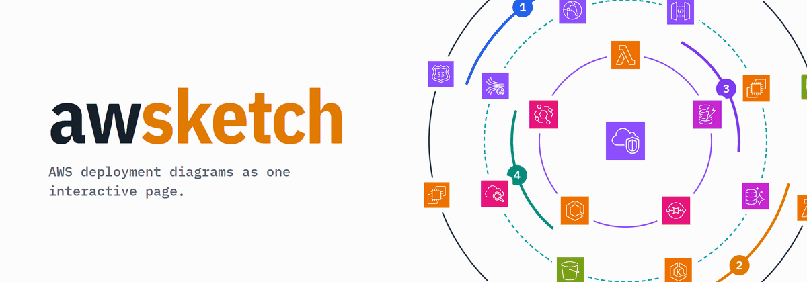
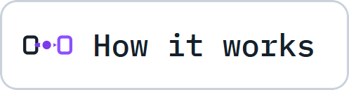
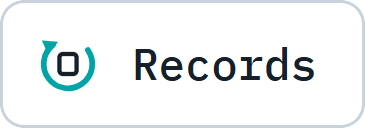
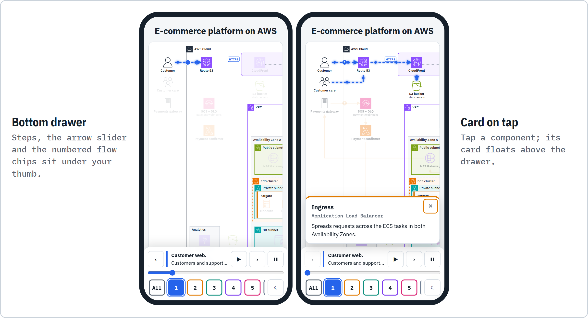

<h1 align="center"><picture><source media="(prefers-color-scheme: dark)" srcset="assets/hero-spin-dark.gif"></picture></h1>

**Ask your agent for an AWS architecture diagram and get one interactive page: official AWS icons, nested frames, numbered flows you can walk arrow by arrow, and a card that explains every component.**

<div align="center">
<p align="center"> <a href="#install"><picture><source media="(prefers-color-scheme: dark)" srcset="assets/nav-install-dark.webp"></picture></a> <a href="#what-you-get"><picture><source media="(prefers-color-scheme: dark)" srcset="assets/nav-what-dark.webp"></picture></a> <a href="#how-it-works"><picture><source media="(prefers-color-scheme: dark)" srcset="assets/nav-how-dark.webp"></picture></a> <a href="#use"><picture><source media="(prefers-color-scheme: dark)" srcset="assets/nav-use-dark.webp"></picture></a> <a href="#records-mode"><picture><source media="(prefers-color-scheme: dark)" srcset="assets/nav-records-dark.webp"></picture></a> <a href="#aws-icons"><picture><source media="(prefers-color-scheme: dark)" srcset="assets/nav-aws-dark.webp"></picture></a> </p>
</div>

<a name="install"></a>

## <picture><source media="(prefers-color-scheme: dark)" srcset="assets/icon-install-dark.webp"></picture> Install

You need [Node.js](https://nodejs.org/) 22.20 or later for the installer, and [uv](https://docs.astral.sh/uv/) and a browser to use the skill. From your project's folder:

```sh
npx skills add the-khiem7/AWSketch
```

The [skills CLI](https://github.com/vercel-labs/skills) finds the awsketch skill in this repository and installs it for the coding agents it detects on your machine; Claude Code, Codex, Cursor and OpenCode are among the many it supports. By default the skill goes into the current project, so your team gets it with the repository.

<a name="what-you-get"></a>

## <picture><source media="(prefers-color-scheme: dark)" srcset="assets/icon-what-dark.webp"></picture> What you get

<picture><source media="(prefers-color-scheme: dark)" srcset="assets/product-dark.webp"></picture>

- **The real AWS look.** Official AWS Architecture Icons on a white drawing sheet, inside nested account, region, VPC, subnet and cluster frames.
- **Flows that tell the story.** Every flow is a numbered, colour-coded chip. Press one to highlight its path; a timeline walks it arrow by arrow.
- **Answers on click.** Click any component for a card with its name, its AWS service and its role.
- **One file to share.** A single HTML page that opens in a browser. On a phone the controls move to a bottom drawer.
- **Light on dependencies.** The renderer needs only uv: it runs on the Python standard library and ships the icons, so it works offline.

<picture><source media="(prefers-color-scheme: dark)" srcset="assets/phone-dark.webp"></picture>

A finished example ships in [`examples/ecommerce-on-aws/`](examples/ecommerce-on-aws/): the spec and the page it renders to.

<a name="how-it-works"></a>

## <picture><source media="(prefers-color-scheme: dark)" srcset="assets/icon-how-dark.webp"></picture> How it works

<picture><source media="(prefers-color-scheme: dark)" srcset="assets/how-dark.webp"></picture>

Your agent writes a JSON spec; the renderer validates it and fills a fixed page shell, so every diagram has the same look and behaviour. You iterate on the spec, never on the HTML.

<a name="use"></a>

## <picture><source media="(prefers-color-scheme: dark)" srcset="assets/icon-use-dark.webp"></picture> Use

Ask for an AWS architecture or deployment diagram, or for a change to one you already have:

```text
Draw the AWS deployment of this repository as an awsketch page.
Add a CloudFront distribution in front of the load balancer in diagrams/shop/shop.json.
```

The agent writes `diagrams/<slug>/<slug>.json` in your repository, one folder per diagram, and renders it. `<skill-dir>` is the folder the skill was installed into, for example `.claude/skills/awsketch` or `.agents/skills/awsketch`:

```sh
uv run <skill-dir>/scripts/render.py diagrams/<slug>/<slug>.json -o diagrams/<slug>/<slug>.html
uv run <skill-dir>/scripts/render.py diagrams/<slug>/<slug>.json --check
uv run <skill-dir>/scripts/render.py --list-icons
```

Errors stop the render with exit code 1; warnings are printed and the page is still written.

<a name="records-mode"></a>

## <picture><source media="(prefers-color-scheme: dark)" srcset="assets/icon-records-dark.webp"></picture> Records mode

Keep a diagram true to the documents it was drawn from. Put the spec in `docs/diagrams/<slug>/` with a sources file and a decisions file beside it, and let `records.py` tell you what changed in the sources since the last stamp.

<picture><source media="(prefers-color-scheme: dark)" srcset="assets/sources-dark.webp"></picture>

<picture><source media="(prefers-color-scheme: dark)" srcset="assets/records-dark.webp"></picture>

```sh
uv run <skill-dir>/scripts/records.py init docs/diagrams/<slug>/<slug>.json --prefix ABC
uv run <skill-dir>/scripts/records.py check docs/diagrams/<slug>
uv run <skill-dir>/scripts/records.py show docs/diagrams/<slug> <node-id>
uv run <skill-dir>/scripts/records.py stamp docs/diagrams/<slug>
```

`<skill-dir>/references/records.md` holds the file format and the workflow.

<details>
<summary><b>Updating the icons</b> - pull in a newer AWS Architecture Icons package</summary>

Download the current package from the [AWS Architecture Icons](https://aws.amazon.com/architecture/icons/) page, then:

```sh
uv run <skill-dir>/scripts/sync_aws_icons.py <Icon-package.zip>
```

New icons are added under `<skill-dir>/assets/icons/`, existing ones are never overwritten, and `index.json` and `references/icon-catalog.md` are regenerated.

</details>

<a name="aws-icons"></a>

## <picture><source media="(prefers-color-scheme: dark)" srcset="assets/icon-aws-dark.webp"></picture> AWS icons

The SVG files under `awsketch/assets/icons/` are the AWS Architecture Icons, copyright Amazon Web Services, and are included so the skill works offline from a clone. awsketch is free and non-commercial. The banner shows the icons unaltered and is not affiliated with or endorsed by AWS. Read the terms on the [AWS Architecture Icons](https://aws.amazon.com/architecture/icons/) page before reusing them outside this skill.