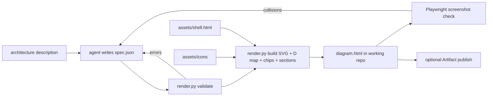

# awsketch - Source Code

Built: `sync_aws_icons.py`, the icon library, `assets/shell.html`, `render.py`, `SKILL.md`, `references/spec-format.md`, `references/layout-rules.md`, `README.md`. Local only: the install junction `.claude/skills/awsketch`.

## Topology

```text
AWSketch/
  README.md
  docs/baseline/awsketch/             this pack
  awsketch/
    SKILL.md
    references/spec-format.md
    references/layout-rules.md
    references/icon-catalog.md        generated
    assets/shell.html
    assets/icons/<kind>/<category>/<id>.svg   group icons: assets/icons/group/<id>.svg
    assets/icons/index.json                   id -> {name, kind, category, path, viewBox, size}
    scripts/sync_aws_icons.py
    scripts/render.py
```

## Execution flow



## Spec format

```json
{
  "title": "Example platform on AWS",
  "intro": "One paragraph of header text.",
  "canvas": {"w": 1480, "h": 830},
  "flows": [{"id": "web", "label": "Web and softphone", "color": "#2563EB"}],
  "groups": [{"type": "region", "x": 358, "y": 48, "w": 1094, "h": 762, "label": "AWS Region", "sub": "one region"}],
  "pools": [{"id": "l-exp", "x": 642, "y": 138, "w": 312, "h": 114, "color": "#2563EB", "title": "Control plane", "note": "", "lines": ["Web app + API"], "detail": ["Control plane", "EKS pods", "text"]}],
  "nodes": [{"id": "alb", "icon": "alb", "x": 476, "y": 224, "w": 130, "size": 44, "label": "Application LB", "sub": ["HTTPS 443"], "detail": ["Ingress", "Application Load Balancer", "text"]}],
  "edges": [{"flow": "web", "points": [[565, 250], [600, 250], [600, 196], [640, 196]], "dashed": false, "start": false, "end": true}],
  "labels": [{"flow": "web", "x": 575, "y": 244, "text": "HTTPS", "anchor": "start"}],
  "badges": [{"flow": "web", "x": 205, "y": 142}],
  "trunks": [{"points": [[316, 432], [384, 432]]}],
  "connectors": [{"points": [[541, 174], [541, 226]]}],
  "texts": [{"x": 1318, "y": 218, "class": "ns2", "anchor": "middle", "text": "free text"}],
  "hint": "Tap any box or icon for what it does. On a phone, swipe the diagram sideways.",
  "sections": [{"title": "The five flows", "open": true, "ordered": true, "items": [{"lead": "Web and softphone.", "text": "text"}]}]
}
```

## Group styles

| Type | Fill / stroke | Icon |
|---|---|---|
| `aws-cloud` | none / `#232F3E` | group-aws-cloud |
| `region` | none / `#00A4A6` dash 6 4, label `#007D7F` | group-region |
| `vpc` | none / `#8C4FFF` | group-virtual-private-cloud-vpc |
| `public-subnet` | `#F2F6E8` / `#7AA116` | group-public-subnet |
| `private-subnet` | `#E6F6F7` / `#00A4A6` | group-private-subnet |
| `eks` | `#FFF7F0` / `#ED7100` dash 3 3 | amazon-elastic-kubernetes-service (no group icon exists) |
| `corp` | none / `#7D8998` | group-corporate-data-center |
| `services` | `#F7F8FA` / `#C7CDD6` | none |
| `highlight` | `#F7F2FF` / `#8C4FFF` 1.6, rx 8 | none |

Flow palette: `#2563EB`, `#E07A00`, `#7C3AED`, `#0E8F7E`, `#64748B`. Pool bar colours seen: `#2563EB`, `#059669`, `#7C3AED`, `#D97706`.

## Renderer rules

- Node height when omitted: `4 + size + 15 + 13*len(sub) + 8`.
- Icon at `(x + w/2 - size/2, y + 4)`; `.nl` at `icon_y + size + 15`; `.ns` sublines every 13px.
- Pool: title at `y + 22`, lines from `y + 44` every 18px, `note` as `.ns` at `x + 98` on the title row.
- Each flow generates a CSS variable, `.f-/.mk-/.c-/.b-` classes, one `<marker>` with `orient="auto-start-reverse"`, one chip and one `body[data-flow]` rule; badge numbers follow `flows` order.
- Waypoints render as `M x y` then `H` or `V` per segment.
- `assets/shell.html` is filled by plain string replacement of `{{title}}`, `{{intro}}`, `{{flow_vars}}` (one `--<flow>:<colour>;` per flow), `{{flow_rules}}` (per flow: `path.f-`, `.mk-`, `.c-`, `.b-` and the `body[data-flow]` rule), `{{chips}}`, `{{svg}}` (the whole `<svg id="dia">` element), `{{hint}}`, `{{sections}}` and `{{detail_map}}` (the `D` object literal); never `str.format`, because the shell script holds `${...}` and braces.
- Only icons referenced by groups or nodes are inlined into `<defs>`, each icon file (a standalone `<svg>`, located through its `path` in `index.json`) converted to a `<symbol>`.

## Validator

| Check | Level |
|---|---|
| Unknown icon, duplicate id, unknown flow id, more than 6 flows, invalid JSON | error |
| Edge segment not axis-aligned | error |
| Two node hit boxes overlap, or a node extends past the canvas | error |
| Label or subline wider than node `w` (7px per char at 13px, 6.2px at 11.5px) | warn |
| Edge endpoint more than 8px from any node, pool or group edge | warn |
| Clickable node without `detail` | warn |
| Non-ASCII dash in text | warn |
