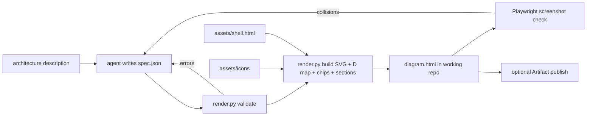

# awsketch - Source Code

Built: `sync_aws_icons.py`, the icon library, `assets/shell.html`, `render.py`, `SKILL.md`, `references/spec-format.md`, `references/layout-rules.md`, `README.md`. Local only: the install junction `.claude/skills/awsketch`.

## Topology

```text
AWSketch/
  README.md
  docs/baseline/awsketch/             this pack
  awsketch/
    SKILL.md
    references/spec-format.md
    references/layout-rules.md
    references/icon-catalog.md        generated
    references/records.md             records mode format and workflow
    assets/shell.html
    assets/icons/<kind>/<category>/<id>.svg   group icons: assets/icons/group/<id>.svg
    assets/icons/index.json                   id -> {name, kind, category, path, viewBox, size}
    scripts/sync_aws_icons.py
    scripts/render.py
    scripts/records.py                records mode: init, lint, check, routes, show, next-id, stamp
```

## Execution flow



## Spec format

```json
{
  "title": "Example platform on AWS",
  "intro": "One paragraph of header text.",
  "canvas": {"w": 1480, "h": 830},
  "flows": [{"id": "web", "label": "Web and softphone", "color": "#2563EB"}],
  "groups": [{"type": "region", "x": 358, "y": 48, "w": 1094, "h": 762, "label": "AWS Region", "sub": "one region"}],
  "pools": [{"id": "l-exp", "x": 642, "y": 138, "w": 312, "h": 114, "color": "#2563EB", "title": "Control plane", "note": "", "lines": ["Web app + API"], "detail": ["Control plane", "EKS pods", "text"]}],
  "nodes": [{"id": "alb", "icon": "alb", "x": 476, "y": 224, "w": 130, "size": 44, "label": "Application LB", "sub": ["HTTPS 443"], "detail": ["Ingress", "Application Load Balancer", "text"]}],
  "edges": [{"flow": "web", "points": [[565, 250], [600, 250], [600, 196], [640, 196]], "dashed": false, "start": false, "end": true, "from": "alb", "to": "l-exp"}],
  "labels": [{"flow": "web", "x": 575, "y": 244, "text": "HTTPS", "anchor": "start"}],
  "badges": [{"flow": "web", "x": 205, "y": 142}],
  "trunks": [{"points": [[316, 432], [384, 432]]}],
  "connectors": [{"points": [[541, 174], [541, 226]]}],
  "texts": [{"x": 1318, "y": 218, "class": "ns2", "anchor": "middle", "text": "free text"}],
  "hint": "Tap any box or icon for what it does. On a phone, swipe the diagram sideways.",
  "sections": [{"title": "The five flows", "open": true, "ordered": true, "items": [{"lead": "Web and softphone.", "text": "text"}]}]
}
```

## Group styles

| Type | Fill / stroke | Icon |
|---|---|---|
| `aws-cloud` | none / `#232F3E` | group-aws-cloud |
| `region` | none / `#00A4A6` dash 6 4, label `#007D7F` | group-region |
| `vpc` | none / `#8C4FFF` | group-virtual-private-cloud-vpc |
| `public-subnet` | `#F2F6E8` / `#7AA116` | group-public-subnet |
| `private-subnet` | `#E6F6F7` / `#00A4A6` | group-private-subnet |
| `eks` | `#FFF7F0` / `#ED7100` dash 3 3 | amazon-elastic-kubernetes-service (no group icon exists) |
| `ecs` | `#FFF7F0` / `#ED7100` solid | amazon-elastic-container-service (no group icon exists); AK-D20 |
| `corp` | none / `#7D8998` | group-corporate-data-center |
| `services` | `#F7F8FA` / `#C7CDD6` | none |
| `highlight` | `#F7F2FF` / `#8C4FFF` 1.6, rx 8 | none |

Flow palette: `#2563EB`, `#E07A00`, `#7C3AED`, `#0E8F7E`, `#64748B`, `#DB2777`, then `#0891B2`, `#65A30D`, `#B45309`, `#BE123C`; no limit on the number of flows (AK-D29). Plain arrow and connector colour: `PLAIN_COLOR` `#7D8998`. Pool bar colours seen: `#2563EB`, `#059669`, `#7C3AED`, `#D97706`.

## Renderer rules

- Node height when omitted: `4 + size + 15 + 13*len(sub) + 8`.
- Icon at `(x + w/2 - size/2, y + 4)`; `.nl` at `icon_y + size + 15`; `.ns` sublines every 13px.
- Pool: title at `y + 22`, lines from `y + 44` every 18px, `note` as `.ns` at `x + 98` on the title row.
- Each flow generates a CSS variable, `.f-/.mk-/.c-/.b-` classes, one `<marker>` with `orient="auto-start-reverse"`, one chip and one `body[data-flow]` rule; badge numbers follow `flows` order.
- Waypoints render as `M x y` then `H` or `V` per segment, after `route()` moves the ends: ports per node side, `PORT_GAP` 20 apart, centred on the icon (left, right, top) or box (bottom), corner moved along; `nudge_off_titles()` slides an end segment off a group title; ends then touch the icon side, icon top or box bottom, `END_GAP` 2 short (AK-D24).
- A dashed edge gets `stroke-dasharray` from `dash_fit()`: `7 5` scaled so the line starts on a dash and a dash sits on the arrowhead back, `HEAD_BACK` = 8 x 0.6 x 2.2 (AK-D25).
- Paths, label groups `g.fl` (an empty `rect.flbox` plus the `.flabel` text) and badges carry `data-e`, the edge index; a label or badge takes the nearest edge of its flow (`owner()`, AK-D27).
- Every `path.flow` carries `data-from` / `data-to` from `edge_ends()`: explicit `from` / `to` first, else the nearest node within `END_REACH` (14) of each end by `rect_dist`, then a clickable pool; an end touching only a group boundary gets `data-from-group` / `data-to-group` with the group label (by `edge_dist`). The shell uses these for the neighbourhood highlight, the spotlight and the step captions (AK-D14).
- An edge with no `flow` is a plain arrow: `<path class="plain">` with inline grey stroke 1.6 and `marker-*` `m-plain`, routed by `route()` like any edge, carrying no `data-from` / `data-to`, so the shell's `path.flow` list, chips and walk never see it (AK-D30). Each connector goes through `snap_connector()`, which moves an end within `END_REACH` of a node onto the icon side, icon top or box bottom (AK-D31).
- Chips render as `<i>` colour dot, `.n` number, `.t` label, with `aria-label="Flow N: label"`; the SVG root is `role="group"` because it holds focusable nodes.
- `assets/shell.html` is filled by plain string replacement of `{{title}}`, `{{intro}}`, `{{flow_vars}}` (one `--<flow>:<colour>;` per flow), `{{flow_rules}}` (per flow: `path.f-`, `.mk-`, `.c-`, `.b-` and the `body[data-flow]` rule), `{{chips}}`, `{{svg}}` (the whole `<svg id="dia">` element), `{{hint}}`, `{{sections}}` and `{{detail_map}}` (the `D` object literal); `{{intro}}` fills the caption slot, not the header; never `str.format`, because the shell script holds `${...}` and braces.
- Only icons referenced by groups or nodes are inlined into `<defs>`, each icon file (a standalone `<svg>`, located through its `path` in `index.json`) converted to a `<symbol>`.

## Page shell script

One block in `assets/shell.html`, state in `flow`, `walking`, `pin`, `hops`, `h`:

| Part | Behaviour |
|---|---|
| Chips | Set `body[data-flow]`, spotlight (`.on` arrows, `.lit` icons), caption, then `overview()` |
| Timeline | `overview()` is step 0; `paint()` draws step `h` of `hops` (pressed flow's arrows, or all); `#pv` / `#pl` / `#nx` / `#scrub` drive `h`; Escape returns to step 0 |
| Motion | `traffic()` adds `animateMotion` packets; `#motion` pauses them and the dash animation; always on, the OS reduced-motion setting is not read (AK-D23); `march` runs from offset 0 on `path.flow` only (AK-D26) |
| Neighbourhood | `nbOn()` on hover or focus lights the node's arrows and ends and the labels and badges with the same `data-e`; no tip (AK-D27) |
| Label boxes | `fitLabels()` sizes each `.flbox` from its text's `getBBox()` on load and after `document.fonts.ready`; the box shows for a linked, pressed or walked label |
| Card | `openPop()` positions `#pop` next to the icon (CSS pins it above the drawer on a phone); Tab stays inside; Escape closes |
| Notes | `localStorage` key `awsk-notes-<path>`; inline form; Enter on a focused icon places one |
| Night / rail | `localStorage` `awsk-night`, `awsk-rail`; Night adds `.tile` rects once |
| Phone | `layout()` on the `(max-width:700px)` change moves Night into the chip row and makes the caption a tap-to-open button; `follow()` scrolls the current arrow into view; `--dh` holds the drawer height |

## Validator

| Check | Level |
|---|---|
| Unknown icon, duplicate id, unknown flow id (an edge may name none, a label or badge may not), invalid JSON | error |
| Edge segment not axis-aligned | error |
| Edge `from` / `to` that is not a node or pool id | error |
| Two node hit boxes overlap, or a node extends past the canvas | error |
| Label or subline wider than node `w` (7px per char at 13px, 6.2px at 11.5px) | warn |
| Edge endpoint more than 8px from any node, pool or group edge | warn |
| Clickable node without `detail` | warn |
| Non-ASCII dash in text | warn |
| Flows without an ordered section, or fewer first-section items than flows (AK-D17) | warn |
| Group title plus subtitle wider than the group: label offset + 7 per title char + 8 + 6.5 per subtitle char, against `w - 6` (AK-D21) | warn |
| `layout_warnings()`: arrows side by side under 8 apart, arrow through a group title, label over node icon or text, label on a group border or title, hub over 80 off the middle of 3 or more nodes, straight edge not centrable at both ends, end missing the icon (AK-D28) | warn |

## Records checker

`records.py` finds the record set from the one `.json` in a folder: `<slug>.sources.md` and `<slug>.decisions.md` beside it. Tables are read by `## <title>` heading; a cell splits on unescaped `|`. Fingerprint: first 12 hex of SHA-256 over a section from its heading to the next heading of the same or higher level, trailing spaces stripped and blank-line runs collapsed, or over every line a `code:` regex matches. Watermark: highest `<PREFIX>-<KIND><N>` per kind among a file's headings. Watched folders count `*.md` files whose last stem part is a baseline document name. Files are read as `utf-8-sig`, so a byte order mark does not hide frontmatter. `lint` runs before `check` and `stamp`; `stamp` runs `render.py --check` and writes its result into `## Verified` (AK-D18).
